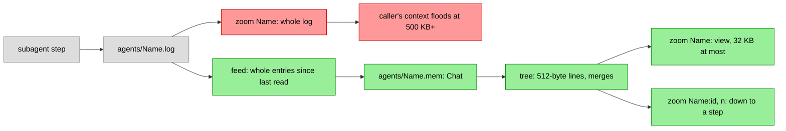

# Subagent memory

A subagent's steps used to live only in `agents/<Name>.log`, and
`zoom("Name")` gave that log whole. A subagent that ran for hours wrote
megabytes: a zoom of one filled or overflowed the caller's context, so a
fresh agent could not pick up its work by reading it.

Now each subagent's chat is a `Chat` of its own in `agents/<Name>.mem`,
with the main chat's code: the same 512-byte lines, pairwise merges, the
same compaction model and prompt, the same view and zoom. Its view is
16 to 32 KB (the main chat's is 64 to 128 KB), small enough for one tool
result. `zoom("Name")` gives the view, and `zoom("Name:id", n)` opens its
line `id+n` as `zoom(id, n)` opens the chat's.

It is on by default. `-agent-memory=false` turns it off: steps go to the
log only, no `.mem` chat is made, `zoom("Name")` gives the whole log as
before, and the prompt and the zoom tool say so.

## How it is fed

The log stays the source. Each subagent has a lock of its own, held over
a step's write to the log and the feed that follows it, and over a zoom's
feed: a feed reads the log from where it last stopped and logs the whole
entries it finds, leaving out thinking, and never reads a step half
written. (Without the lock, a zoom during a long write could cut a step
at a blank line in its text, and the rest of it was lost.) Opened again
(after a restart, or a crash between the log and the chat), a chat skips
as many steps as it holds, counted as its messages' first parts: each
step goes in once. A write cut short (a crash, a full disk) leaves no
blank line, and the next step's head, not after one, would read as text
of the cut step: so before a subagent's first step since its chat opened,
or after a failed write, a log that doesn't end in a blank line gets one.

No lock is shared by all subagents over a file read or write: a first
zoom of one long log holds up no other subagent's steps. The pump that
gives the chats a turn at the compactions copies them under the map's
lock and takes each chat's lock without it: a chat writing to disk holds
up only its own subagent.

Five locks, always taken in this order: the subagents' (`Agent.mu`, held
by a tell as it logs a step), then a subagent's own, then the map of open
subagents' chats, then a chat's, then the count of compactions running. Closing idle chats holds the map's lock, over closing their
files too, and only tries a subagent's own lock and its chat's, so it
never waits against the order, nor on a chat writing a line to disk.

A running subagent's chat is opened at its first step and built as it
works. A subagent from before this change gets its tree at its first
zoom. The zoom answers at once: a line not summarized yet shows the heads
of its first and last messages, so the first view already holds the
task, the last report and where the work went, and the rest is built in
the background. At most 32 subagents' chats stay open; past that the
least used idle ones close and open again from their files when needed.

A compaction in a subagent's chat is told whose chat it is and what its
kinds mean (`tool` there is the subagent's own call, `opt` a message Opt
sent it). A failed one shows on the page as the chat's do, named
`[Name] memory:`, and so does a subagent's chat that can't open; zoom
then says why, not that there is no such subagent.

## Cost

All subagents' chats share `-agent-jobs` compactions at once (2), and
start none while the main chat has a line waiting to be built: the main
chat's come first. A main chat line that keeps failing, waiting to be
tried again, holds up none of them. Counted on real logs, a tree takes
about 1.1 to 1.3 compactions per message, so a 500 KB log takes about 540
compactions, about $0.43 at a Haiku compaction's average of $0.0008, and
about 25 minutes at 2 at once. A 1.4 MB log takes about 1,600. A running
subagent's chat costs this as it works, whether or not it is ever
zoomed: about 1.2 compactions per step.

Measured: a real 72 KB log took 2.5 minutes and $0.036 of Haiku
compactions, for an 8.8 KB view. A real 1.37 MB log's first view,
with a stand-in summarizer, was 18 KB.

## Crashes, a full disk and the off switch

A subagent's memory is a view built from its log, which only grows. So a
crash, a failed write and the off switch come down to one rule: whatever
was cut short where, and whichever way restarts turned `-agent-memory`,
a chat fed to the log's end is the whole log, as if nothing had
happened. In the code:

- A log cut short gets a blank line before the next step, memory on or
  off, so the next step's head never reads as text of the cut one
  (TestAgentMemTornTail, TestAgentMemOffSeals).
- A step longer than `clipMax` goes into the chat in parts. A chat opened
  again after a crash between them writes the missing parts
  (TestAgentMemTornParts).
- A failed write to a subagent's chat (a full disk) stops that chat, not
  opt-chat: it writes nothing more, says so on the page, and zoom gives
  the whole log or says why it can't. The next feed opens it again from
  its files and catches up. An open that fails closes the chat's lock
  file, so the open once the disk has room works. The main chat's failed
  writes stay fatal (TestAgentMemWriteFails, with a read-only file and
  with a file size limit standing in for a full disk: a short write,
  then an error).
- Spawn skips a name that has a `.log` or a `.mem`, so a new subagent
  never takes an old chat for its own (TestAgentMemNameReuse).

## Model-checked

`formal/agentmem/AgentMem.tla` models the log writer, its feed, Opt's
zoom, the pump, compactions saving their lines, closing idle chats, a
write cut short, a failed write to a chat, and a crash or restart that
may turn `-agent-memory` either way, each action one step of the code
between two lock operations. TLC checks seven rules over every order of
those steps, in three scopes (two subagents at once; one subagent with a
crash and a failure; one with two crashes and the off switch): no step
lost, doubled or out of order; a step or zoom never waits on another
subagent's disk; no deadlock; a chat fed to the log's end is the whole
log after any crash; a memory failure shows on the page and never stops
opt-chat. `formal/agentmem/check.sh` runs it (about 6 minutes on 2
cores), and the `agent-memory` skill says when.

While this was written, the model and reviews of it found nine bugs in
drafts. Each is now a mutant in `formal/agentmem/mutants.sh`, which puts
it back and expects its rule to break, and all but the last have a Go
test that failed before the fix: the pump and closing idle chats each
held the map's lock while waiting on one chat's disk; a write cut short
swallowed the next step, memory on or, separately, off; a chat that
couldn't open was told only to the terminal and zoom said the subagent
didn't exist; a crash between a long step's parts lost the rest; a
failed write to a subagent's chat stopped opt-chat; a new subagent took
an old `.mem`; and a compaction's write failing between `fed`'s check
and its feed left a step in memory only. Reviews and tests found two
more: a zoom during a long write cut the step at a blank line, and an
open that failed on a full disk kept the chat's lock, so it never opened
again in that run.

## Prior art

[opencode-optchat](https://github.com/ahlner/opencode-optchat) keeps a
summary tree per session, subagents' included, and keeps a child's
history private to it. UniiChat and pi-optchat page a subagent's log by
characters; neither summarizes it.
